  

# 🚀 Awesome Developer Ecosystem Platform

  
  
  
  
  
  
  

---

> **🌟 An authoritative, curated directory of Internal Developer Portals (IDP), self-hosted Git forges, container registries, API platforms, and AI model hubs.** Compare commercial SaaS ecosystems with battle-tested open-source alternatives.

---

## 📑 Table of Contents

- [📊 Sector Overview & Market Dynamics](#-sector-overview--market-dynamics)
- [☁️ SaaS / Hosted Developer Platforms](#️-saas--hosted-developer-platforms)
- [💻 Open-Source GitHub Projects](#-open-source-github-projects)
- [🤝 How to Contribute](#-how-to-contribute)
- [💖 Support & Sponsorship](#-support--sponsorship)
- [📈 Star History](#--star-history)
- [⚠️ Disclaimer](#️-disclaimer)

---

## 📊 Sector Overview & Market Dynamics

The global Internal Developer Platform (IDP) and developer ecosystem market is valued at over **$7.0 billion** (projected to reach over **$31 billion by 2033** at a **~21% CAGR**). 

The sector exhibits **moderate fragmentation** at the commercial tooling layer (the top 5 commercial vendors capture under 40% of overall enterprise spend across fragmented portals, orchestrators, and API marketplaces), while simultaneously displaying **high concentration** at foundational developer entry points where entrenched category leaders (such as Backstage in internal developer portals and GitHub / GitLab in source control and CI/CD) maintain dominant mindshare.

---

## ☁️ SaaS / Hosted Developer Platforms

A comprehensive benchmark of commercial category leaders, sorted in descending order by parent company valuation / revenue scale:

| 🏢 Platform | 🏷️ Category | 📈 Company Valuation / Revenue | 💳 Pricing (Starting Tier) | 🎁 Free Tier Limits | 🔍 Key Highlights & Trade-offs |
| :--- | :--- | :--- | :--- | :--- | :--- |
| **[Microsoft (GitHub)](https://github.com)** | 🐙 Code Hosting & DevOps Platform | **~$3.1T Valuation** (Parent Microsoft) / ~$2B+ ARR (GitHub) | **$4.00/user/month** (Team tier, billed annually) | **Free forever**: Unlimited public & private repositories, 2,000 CI/CD Actions minutes/month, 500MB GitHub Packages storage, 120 core-hours/month Codespaces, community support. | **Best for**: Teams wanting the largest open-source ecosystem, marketplace integrations, and built-in Actions. **Trade-off**: Cloud lock-in; CI compute minutes capped on free tier. |
| **[Red Hat (Developer / OpenShift)](https://developers.redhat.com)** | 🎩 Enterprise Open-Source & PaaS | **$34B Acquisition** (by IBM; IBM ~$200B+ market cap) | **$0.076/hour** (~$55/month for Red Hat OpenShift Dedicated cluster core) | **Free forever (Developer Program)**: No-cost individual Red Hat Developer Subscription covering 16 physical or virtual nodes of RHEL, self-supported OpenShift Local development runtime, access to developer tools & knowledgebase. | **Best for**: Enterprises needing supported open-source infrastructure and hybrid-cloud deployments. **Trade-off**: Requires commercial enterprise subscriptions for production SLAs and cluster support. |
| **[Atlassian (Bitbucket, Jira, Confluence)](https://www.atlassian.com)** | 🔷 Developer Collaboration Suite | **~$50B+ Market Cap** / ~$4.4B Annual Revenue | **$3.00/user/month** (Bitbucket Standard) / **$7.16/user/month** (Jira Standard) | **Free forever**: Up to 10 users per product across Bitbucket, Jira, and Confluence; includes 50 build minutes/month for Bitbucket Pipelines and 1GB storage. | **Best for**: Teams needing seamless integration across project management, documentation, and source code. **Trade-off**: Ecosystem lock-in; per-product pricing compounds quickly. |
| **[GitLab](https://about.gitlab.com)** | 🦊 Single Application DevOps Platform | **~$8B - $10B Market Cap** / ~$750M+ ARR | **$29.00/user/month** (GitLab Premium) | **Free forever**: Unlimited public & private repos for up to 5 users per namespace, 400 compute minutes/month on shared runners, 5GB storage, and 10GB transfer/month. | **Best for**: Organizations seeking a unified end-to-end DevOps pipeline with source control and CI/CD. **Trade-off**: High leap in starting paid tier ($29/user/month); self-hosted instances have operational overhead. |
| **[HashiCorp Cloud Platform (HCP)](https://cloud.hashicorp.com)** | 🛡️ Cloud Infrastructure Automation | **$6.4B Acquisition** (by IBM) / ~$600M+ Annual Revenue | **$0.021/hour** (~$15/month for HCP Vault Secrets Standard) | **Free forever**: HCP Vault Secrets Free tier (up to 1 app and 25 secrets), HCP Packer Free (up to 10 image buckets), Terraform Free (up to 500 managed resources/month). | **Best for**: Organizations wanting managed Terraform, Vault, Boundary, and Consul infrastructure. **Trade-off**: Terraform core license moved to BSL (OpenTofu is community fork); multi-product consumption costs add up. |
| **[Postman](https://www.postman.com)** | 📮 API Development & Testing Platform | **$5.6B Valuation** / ~$150M+ ARR | **$14.00/user/month** (Basic tier, billed annually) | **Free forever**: Up to 3 team members, unlimited API collections, 25 collection runner executions/month, 1,000 calls/month to mock servers, and Postman API access. | **Best for**: Engineering teams looking for collaborative API design, automated testing, and mock servers. **Trade-off**: Data/collections synced to vendor cloud; collection run volume strictly throttled on free plan. |
| **[Hugging Face](https://huggingface.co)** | 🤗 AI/ML Model Hub & Dataset Platform | **$4.5B Valuation** / ~$70M+ ARR | **$9.00/month** (Pro plan) | **Free forever**: Unlimited public & private model/dataset repositories up to 50GB per repository via LFS, free community Spaces hosting with baseline 2 vCPU / 16GB RAM hardware, and serverless Inference API access. | **Best for**: Machine learning practitioners and AI builders wanting the premier community model catalog. **Trade-off**: Dedicated inference and high-end GPU Spaces require paid compute instances. |
| **[Docker (Docker Hub)](https://hub.docker.com)** | 🐳 Container Registry & Dev Tooling | **$2.1B Valuation** / ~$140M+ ARR | **$5.00/user/month** (Pro tier, billed annually) | **Free forever (Personal)**: Unlimited public container repositories, 1 private repository, up to 200 image pulls per 6 hours (authenticated), Docker Desktop free for individual/small business (<$10M revenue). | **Best for**: Developers and platform teams needing access to canonical base images and container distribution. **Trade-off**: Pull rate limits strictly enforced on unauthenticated/free accounts; single private repo limit. |
| **[Stack Overflow (Teams)](https://stackoverflow.co/teams)** | 📚 Developer Knowledge Base & Q&A | **$1.8B Acquisition** (by Prosus) / ~$100M+ Annual Revenue | **$6.00/user/month** (Basic plan, billed annually) | **Free forever**: Public Q&A community is 100% free; **Stack Overflow for Teams Free** includes up to 50 users forever with structured private Q&A, ChatOps integration (Slack/Teams), and searchable internal documentation. | **Best for**: Organizations seeking to eliminate duplicate developer questions and preserve internal tribal knowledge. **Trade-off**: Public answers are CC BY-SA licensed; advanced analytics and SSO require higher tiers. |
| **[RapidAPI](https://rapidapi.com)** | 🌐 API Marketplace & Enterprise Gateway | **$1.0B Valuation** / ~$40M - $50M ARR | **$9.99/month** (Typical Provider Pro tier starting price) | **Free forever (Basic tier)**: $0/month access to free/freemium API endpoints, typically bounded by 100 to 1,000 calls/month (platform-enforced community ceiling of 1,000 req/hour and 10GB bandwidth/month). | **Best for**: Developers looking to discover, test, and purchase thousands of third-party public APIs through a unified key. **Trade-off**: Overages apply if free quota exceeded on credit-card-backed freemium APIs. |

---

## 💻 Open-Source GitHub Projects

Explore battle-tested open-source software powering the modern developer stack—ranging from developer portals and Git forges to container registries, workflow engines, and AI hubs. **Sorted in descending order by GitHub Stars_Count**:

-  **[Supabase](https://github.com/supabase/supabase)** ⚡  
  **Open source Firebase alternative & developer backend platform** (Apache-2.0) — Complete developer backend providing dedicated PostgreSQL databases, authentication, edge functions, realtime subscriptions, and storage APIs.  
  *Tech stack*: TypeScript, Elixir, Go, PostgreSQL | *Deploy*: Self-hosted (Docker, Kubernetes)

-  **[Hoppscotch](https://github.com/hoppscotch/hoppscotch)** 🛸  
  **Open-source API development ecosystem & Postman alternative** (MIT) — Lightweight, web-first API testing suite with support for REST, GraphQL, and WebSockets, team workspaces, environment variables, and self-hostable servers.  
  *Tech stack*: TypeScript, Vue.js, Node.js | *Deploy*: Self-hosted (Docker)

-  **[Coolify](https://github.com/coollabsio/coolify)** 🧊  
  **Self-hosted developer platform & Heroku/Vercel alternative** (Apache-2.0) — All-in-one PaaS orchestrating applications, databases, and microservices across any server via SSH, with automated SSL, preview deployments, and Git push-to-deploy.  
  *Tech stack*: PHP, Laravel, Docker | *Deploy*: Self-hosted (Docker, VPS)

-  **[Gitea](https://github.com/go-gitea/gitea)** ☕  
  **Lightweight self-hosted Git service** (MIT) — Painless, single-binary self-hosted GitHub alternative with code review, issues, container/package registry, and native GitHub Actions-compatible CI/CD runner support.  
  *Tech stack*: Go, Vue.js | *Deploy*: Self-hosted (Binary, Docker, Kubernetes)

-  **[Kong](https://github.com/Kong/kong)** 🦍  
  **Cloud-native API gateway & service connectivity platform** (Apache-2.0) — High-performance developer API gateway managing traffic routing, authentication, rate-limiting, and developer portal plugins across multi-cloud topologies.  
  *Tech stack*: Lua, OpenResty, C | *Deploy*: Self-hosted (Docker, Kubernetes, VM)

-  **[Drone CI (by Harness)](https://github.com/harness/harness)** 🚁  
  **Container-native continuous integration and delivery platform** (Polyform / Apache) — Cloud-native pipeline engine executing build steps inside isolated Docker containers with declarative YAML configurations.  
  *Tech stack*: Go | *Deploy*: Self-hosted (Docker, Kubernetes)

-  **[Directus](https://github.com/directus/directus)** 🐰  
  **Open-source data engine & internal developer API platform** (BSL-1.1 / Apache-2.0) — Instant REST and GraphQL APIs dynamically mapped to SQL databases, complete with auth, role-based permissions, webhooks, and an administrative app.  
  *Tech stack*: TypeScript, Node.js, Vue.js | *Deploy*: Self-hosted (Docker, Node)

-  **[Backstage](https://github.com/spotify/backstage)** 🎭  
  **Open platform for building developer portals** (Apache-2.0, CNCF Incubating) — The industry-standard framework created by Spotify for building unified developer portals, featuring a central software catalog, scaffolding templates, and TechDocs.  
  *Tech stack*: TypeScript, React, Node.js | *Deploy*: Self-hosted (Kubernetes, Node)

-  **[OpenTofu](https://github.com/opentofu/opentofu)** 🧱  
  **Open-source infrastructure as code tool** (MPL-2.0, Linux Foundation) — Community-driven, fully open-source fork of Terraform ensuring transparent, declarative multi-cloud infrastructure provisioning without BSL constraints.  
  *Tech stack*: Go | *Deploy*: CLI, CI/CD runners

-  **[Harbor](https://github.com/goharbor/harbor)** ⚓  
  **Cloud-native trusted container & artifact registry** (Apache-2.0, CNCF Graduated) — Enterprise Docker Hub replacement offering role-based access control, automated vulnerability scanning (Trivy), image signing (Cosign/Notary), and cross-registry replication.  
  *Tech stack*: Go, Angular | *Deploy*: Self-hosted (Docker Compose, Helm, Kubernetes)

-  **[Dapr](https://github.com/dapr/dapr)** 🧩  
  **Distributed Application Runtime for microservice ecosystems** (Apache-2.0, CNCF Graduated) — Portable, event-driven runtime simplifying developer microservice architectures with pluggable state management, pub/sub, bindings, and secrets.  
  *Tech stack*: Go | *Deploy*: Self-hosted (Kubernetes, Docker)

-  **[GitLab Community Edition (CE)](https://github.com/gitlabhq/gitlabhq)** 🦊  
  **Self-hosted DevOps lifecycle platform** (MIT for CE) — Complete open-source developer platform covering Git hosting, issue tracking, CI/CD runners, container registry, and code review in an integrated environment.  
  *Tech stack*: Ruby on Rails, Go, Vue.js, PostgreSQL | *Deploy*: Self-hosted (Omnibus, Docker, Helm)

-  **[Argo CD](https://github.com/argoproj/argo-cd)** 🐙  
  **Declarative GitOps continuous delivery tool for Kubernetes** (Apache-2.0, CNCF Graduated) — Foundational developer platform component ensuring cluster environments continuously match target states defined in Git repositories.  
  *Tech stack*: Go, TypeScript | *Deploy*: Self-hosted (Kubernetes)

-  **[Temporal](https://github.com/temporalio/temporal)** ⏱️  
  **Open-source durable execution developer platform** (MIT) — Orchestration platform enabling engineers to write resilient, fault-tolerant background workflows, data pipelines, and distributed state machines in standard code.  
  *Tech stack*: Go | *Deploy*: Self-hosted (Docker, Kubernetes)

-  **[Windmill](https://github.com/windmill-labs/windmill)** 💨  
  **Developer platform for internal tools and workflow automation** (AGPL-3.0 / Apache-2.0) — High-performance developer platform turning scripts (Python, TypeScript, Go, SQL, Bash) into auto-generated internal UIs, workflows, and endpoints.  
  *Tech stack*: Rust, Svelte, PostgreSQL | *Deploy*: Self-hosted (Docker, Kubernetes)

-  **[DevPod](https://github.com/loft-sh/devpod)** 💻  
  **Open-source Codespaces alternative for repeatable dev environments** (MPL-2.0) — Provider-neutral client turning any cloud, Kubernetes cluster, or bare-metal machine into reproducible, containerized developer environments using `devcontainer.json`.  
  *Tech stack*: Go, TypeScript | *Deploy*: Desktop CLI / Docker / Cloud VMs

-  **[Woodpecker CI](https://github.com/woodpecker-ci/woodpecker)** 🪵  
  **Community-driven container-native CI/CD platform** (Apache-2.0) — Simple, multi-architecture continuous integration engine with pipeline steps running inside isolated containers, serving as a lightweight alternative to heavyweight CI stacks.  
  *Tech stack*: Go | *Deploy*: Self-hosted (Docker Compose, Kubernetes)

-  **[Kubero](https://github.com/kubero-dev/kubero)** 🚢  
  **Self-hosted developer PaaS on Kubernetes** (MIT) — Streamlined developer platform turning raw Kubernetes clusters into a Heroku-like self-service deployment experience with Git webhooks, add-ons, and CLI controls.  
  *Tech stack*: TypeScript, Go | *Deploy*: Self-hosted (Kubernetes, Helm)

-  **[CSGHub](https://github.com/OpenCSGs/csghub)** 🧠  
  **Open-source AI model, dataset, and agent platform** (Apache-2.0) — Comprehensive self-hosted Hugging Face alternative supporting open model and dataset lifecycle management, SDK compatibility, finetuning, and containerized Spaces.  
  *Tech stack*: Go, Vue.js, Python | *Deploy*: Self-hosted (Helm, Docker Compose)

-  **[Zot](https://github.com/project-zot/zot)** 📦  
  **Vendor-neutral OCI-native container registry** (Apache-2.0) — High-throughput, pure OCI-compliant registry featuring vulnerability scanning, digital signature validation, and Docker-compatible distribution with minimal resource footprint.  
  *Tech stack*: Go | *Deploy*: Self-hosted (Docker, Binary, Kubernetes)

-  **[APIPark](https://github.com/APIParkLab/APIPark)** 🌲  
  **Open-source AI gateway & developer API portal** (Apache-2.0) — Developer platform integrating high-performance API routing, full-lifecycle internal API developer portals, usage auditing, and unified AI model invocation endpoints.  
  *Tech stack*: Go, React | *Deploy*: Self-hosted (Docker, Helm)

-  **[OpenChoreo](https://github.com/openchoreo/openchoreo)** 🪐  
  **Open-source Internal Developer Platform for Kubernetes** (Apache-2.0) — Production-ready IDP control plane (originally created by WSO2) offering developer abstractions, built-in GitOps, Backstage portal integration, and AI SRE agents.  
  *Tech stack*: Go, Kubernetes | *Deploy*: Self-hosted (Kubernetes)

-  **[MatrixHub](https://github.com/matrixhub-ai/matrixhub)** 🔮  
  **High-performance self-hosted AI model registry** (Apache-2.0) — Drop-in Hugging Face replacement with multi-node 10Gbps+ caching, air-gapped distribution, malware verification, and native `HF_ENDPOINT` compatibility.  
  *Tech stack*: Go | *Deploy*: Self-hosted (Docker Compose, Helm)

-  **[Miabi](https://github.com/miabi-io/miabi)** 🌸  
  **Self-hosted application platform & PaaS** (MIT) — Lightweight GitOps application platform featuring database provisioning, automated TLS, and role-based access control for indie developers and micro-teams.  
  *Tech stack*: Go, TypeScript | *Deploy*: Self-hosted (Docker)

---

## 🤝 How to Contribute

Contributions are welcome! Please follow these simple steps:

1. 🍴 **Fork the repository**.
2. 🌿 **Create a new branch** (`git checkout -b feature/add-tool`).
3. 📝 **Add/edit entries** in `README.md` adhering to the table schema and format (name, repo link, Stars_Badge, 1–2 sentence description, license, tech stack).
4. 🚀 **Commit & push** (`git commit -m "feat: add NewTool to ecosystem list"`).
5. 📬 **Submit a Pull Request** with a concise description of why the tool fits the Developer Ecosystem category.

---

## 💖 Support & Sponsorship

Thank you for exploring and utilizing **Awesome-Developer-Ecosystem-Platform**! ⭐

If you find this curated list valuable for your team or personal projects, please consider supporting the project:

- ⭐ **Star this repository** to help others discover it on GitHub.
- 🍴 **Fork and share** it across developer communities, social media, and internal engineering channels.
- ☕ **Buy me a coffee / Sponsor**: If this saved you time or research effort, support ongoing maintenance and curation on the [GitHub Sponsor Dashboard](https://github.com/sponsors/ishandutta2007).

  

---

##  Star History

---

## ⚠️ Disclaimer

- This is a **community-curated** list — not exhaustive and not an endorsement.
- Developer ecosystem platforms handling code, credentials, and models must comply with data protection regulations (GDPR, CCPA, etc.) and implement appropriate access controls.
- **The "SaaS ecosystem" vs. "self-hosted forge" vs. "internal developer platform" vs. "registry" distinction is critical.** **GitHub, GitLab, Docker Hub, Hugging Face, Postman, and Atlassian** are **SaaS ecosystems**—they provide hosting, network effects, and integrated tooling. **Gitea and GitLab CE** are **self-hosted forges**—they replace code hosting but not community. **OpenChoreo and Backstage** are **internal developer platforms**—they portal and orchestrate, not host code. **Zot and Harbor** are **registries**—they store images, not code or models. **CSGHub and MatrixHub** are **model hubs**—they store models, not code. **Choose based on which layer of the developer ecosystem you need to own.**
- **OpenChoreo is a comprehensive open-source IDP** with batteries-included CI/CD, GitOps, observability, and AI agents—originally from WSO2's SaaS platform. **The trade-off**: Kubernetes-native; requires cluster infrastructure.
- **Gitea is the easiest self-hosted GitHub alternative**—single binary, Docker in minutes, and Gitea Actions for GitHub Actions compatibility. **GitLab CE is the most complete**—CI/CD, registry, and security in one platform. **Choose Gitea for simplicity; choose GitLab for completeness.**
- **Zot is the standards-compliant registry**—pure OCI, lightweight, Docker-compatible. **Harbor is the enterprise registry**—RBAC, scanning, replication. **Choose Zot for simplicity; choose Harbor for governance.**
- **CSGHub and MatrixHub both replace Hugging Face** but with different priorities. CSGHub offers full lifecycle management and Hugging Face SDK compatibility. MatrixHub focuses on performance—10Gbps+ distribution across 100+ GPU nodes and air-gapped delivery. **Choose CSGHub for ecosystem breadth; choose MatrixHub for inference performance.**
- **HashiCorp's Terraform moved to BSL** (not OSI open source)—OpenTofu is the community fork. **For teams requiring OSI-licensed IaC, OpenTofu is the alternative.**
- Self-hosted open-source solutions require proper infrastructure (Kubernetes for OpenChoreo, Docker for Gitea/Zot, Helm for CSGHub/MatrixHub), security hardening, and ongoing maintenance. **Developer platforms handle credentials and proprietary code**—ensure your deployment meets your organization's security standards before migrating production workloads.

---

  <b>Built for platform engineers, developer experience teams, and organizations building transparent developer ecosystem solutions.</b> 
  Let's make Developer Ecosystem Platforms more open, data-driven, and developer-owned.

